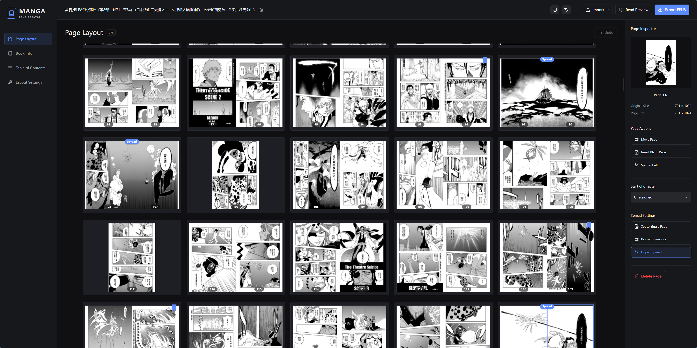
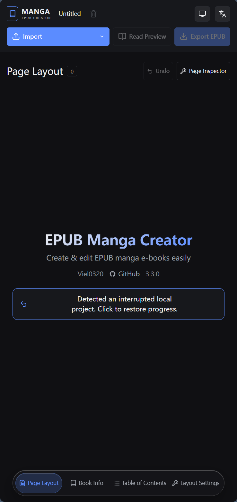

# EPUB Manga Creator

English | [简体中文](README_CN.md)

A modern, fast web-based GUI utility to bundle comic and manga images into EPUB 3.0 format.

The generated EPUB structure conforms to the specifications of the [Digital Comic Association](http://www.digital-comic.jp/) (デジタルコミック協議会).

🚀 **[Click here to use the app](https://viel0320.github.io/epub-manga-creator)**

---

## Preview






---

## Features

- **Modern Build Stack**: Powered by **Vite 8**, **React 19**, **TypeScript 7**, and **MobX 6** for blazing-fast development startup, instant Hot Module Replacement (HMR), and optimized production builds.
- **PNPM Package Manager**: Dependency management powered by **pnpm** for faster installs and efficient disk usage.
- **Flexible Import Pipeline**: Import images (PNG / JPEG / WebP / AVIF / GIF), **ZIP / CBZ archives** (natural-sorted, MIME-detected by magic bytes), or existing EPUB files — everything is processed locally in the browser.
- **Auto Workspace Persistence**: Client-side IndexedDB persistence engine automatically saves working state, page Blobs, and configuration in real time; on relaunch, a one-click restore prompt resumes the interrupted session.
- **Dual EPUB 2 & EPUB 3 Parser & Re-import**: Full-featured EPUB importer capable of parsing existing EPUB files. Fully compatible with both EPUB 3 (`<nav epub:type="toc">`, `properties="cover-image"`) and EPUB 2 (`toc.ncx`, `<guide>`, `<meta name="cover">`) standards.
- **Standardized Page Fit Modes**: Flexible layout fitting supporting `contain` (fit), `cover` (crop), and `fill` (stretch) with dynamic SVG `preserveAspectRatio` and CSS `object-fit` alignment.
- **Interactive Lightbox Reader**: Fullscreen interactive preview reader with swipe navigation for inspecting single-page and double-page spread layouts.
- **Automatic TOC Generation**: Generate a table of contents with locale-aware titles, aligned with the displayed page numbering.
- **Rich Page Tooling**: Pointer-based drag & drop reordering (mouse + touch), in-place image replacement, blank-page insertion, page splitting / spread merging, and a single-level undo for page operations.
- **Responsive & Mobile-Ready**: Adaptive workspace shell with a floating bottom-bar navigation capsule, a slide-in page inspector drawer, and touch gestures on narrow viewports.
- **Light / Dark / Auto Theming**: Theme cycling that follows the system color scheme by default.
- **Localisation (L10n)**: Built-in support for **English** and **Chinese**.
  - Automatically detects browser language settings upon first load.
  - Seamless, state-managed language switching from the workspace header.
  - Persists preference locally (`localStorage`).
- **Installable PWA**: Web app manifest and app icons for installation on supported platforms.
- **Domain-specific Features**:
  - Image pagination, split-page support, reading direction configuration (Japanese RTL or LTR).
  - Pre-defined suggestion lists for subjects and Japanese publishers.
  - "Saved Sets" for reuse of metadata presets.

---

## Cross-Platform Reader Compatibility

This project focuses on producing a **single, unified EPUB file** that delivers reliable compatibility across diverse e-reading devices and software. The following matrix details real-world testing results and platform behaviors:

| Reader / App                                                                        | Tested Platform                     |  Spine Spread  | Compatibility Notes & Behavior                                                                                                                       |
| :---------------------------------------------------------------------------------- | :---------------------------------- | :------------: | :--------------------------------------------------------------------------------------------------------------------------------------------------- |
| [Starrea](https://apps.microsoft.com/detail/9p8xwg60cqd2)                           | Windows                             | ❌ Unsupported | Does not support image stretch styling                                                                                                               |
| [Readest](https://github.com/readest/readest)                                       | Android / Windows                   |  ✅ Supported  | Overrides custom image styles                                                                                                                        |
| [Calibre](https://calibre-ebook.com/)                                               | Windows                             | ❌ Unsupported | Built-in reader does not support spine page-spreads                                                                                                  |
| [Rodel Reader](https://apps.microsoft.com/detail/9p6796l4r67r) _(Manga mode)_       | Windows                             |  ✅ Supported  | Custom rendering engine strips inline CSS styles                                                                                                     |
| [Kindle Apps & Devices](https://www.amazon.com/sendtokindle) _(via Send to Kindle)_ | Android / Windows / KindleOS (KPW5) |  ✅ Supported  | Overrides image styles; cross-page preview may trigger unexpectedly due to Kindle's layout algorithm (spine spread logic itself functions correctly) |
| [Jane Reader](https://janereader.com)                                               | Windows                             | ❌ Unsupported | Overrides image styles                                                                                                                               |
| [Koodo Reader](https://www.koodoreader.com/zh)                                      | Web / Windows                       | ❌ Unsupported | Overrides image styles                                                                                                                               |
| [KOReader](https://github.com/koreader/koreader)                                    | Android / Kindle HF                 | ❌ Unsupported | Overrides image styles and reading direction                                                                                                         |

---

## Development

### Prerequisites

- **Node.js**: v24.x or newer
- **Package Manager**: [PNPM](https://pnpm.io/)

### Getting Started

1. **Install Dependencies**

   ```bash
   pnpm install
   ```

2. **Start Development Server**

   ```bash
   pnpm start
   ```

   Open your browser to the URL printed in the terminal (usually `http://localhost:5173`).

3. **Build for Production**

   ```bash
   pnpm build
   ```

   Compiles TypeScript and bundles static assets into the `dist/` directory.

4. **Preview Production Build**

   ```bash
   pnpm preview
   ```

   Starts a local server to test the production bundle in the `dist/` directory.

---

## Acknowledgements

Special thanks to the following upstream projects for their inspiration and foundational work:

- [wing-kai/epub-manga-creator](https://github.com/wing-kai/epub-manga-creator)
- [Joycai/epub-manga-creator](https://github.com/Joycai/epub-manga-creator)
